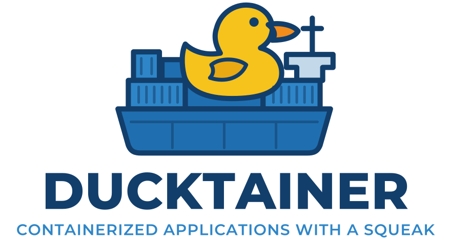

<p align="center"></p>

# ducktainer

[](https://github.com/leandrofus/ducktainer/actions/workflows/ci.yml)

**Administración de Docker sin agente, en un único binario.** Incluye:

- UI web tipo CRM: clic derecho en todo, vistas guardadas, kanban y paleta ⌘K;
- stacks compose con editor visual;
- marketplace de apps;
- logs en vivo y terminales web.

Se entra con los **usuarios del sistema** (PAM), y el acceso por red se limita a los hosts que autorices.

[English](README.md) · [sitio web](https://leandrofus.github.io/ducktainer/)

## Puesta en marcha

### 1. Instalar

**Paquetes (recomendado).** Sirven para RHEL/Alma/Rocky 9+, Fedora, Debian 12+ y Ubuntu 22.04+ (amd64 y arm64). Docker tiene que estar instalado: el paquete depende de él.

```sh
sudo dnf install ./ducktainer-0.1.0-1.x86_64.rpm     # RHEL / Fedora
sudo apt install ./ducktainer_0.1.0-1_amd64.deb      # Debian / Ubuntu
```

El paquete:

- crea el usuario `ducktainer` y los grupos `ducktainer-admins` y `ducktainer-viewers`;
- detecta cómo está instalado Docker (`ducktainer setup`);
- deja el servicio `ducktainer` escuchando en `http://127.0.0.1:9900`.

**Binario suelto.** Funciona en Linux, macOS y Windows, pero solo con token (sin PAM):

```sh
./ducktainer serve       # http://127.0.0.1:9900; muestra el token
```

**Windows sin Docker Desktop.** `ducktainer engine` instala el Docker Engine libre por ti, desde una terminal de administrador:

```powershell
.\ducktainer.exe engine install                 # contenedores Linux: Docker en una distribución WSL 2 propia
.\ducktainer.exe engine install --mode native   # contenedores Windows: dockerd.exe como servicio de Windows
.\ducktainer.exe engine status
.\ducktainer.exe ui
```

- `wsl` (por defecto) crea la distribución WSL 2 `ducktainer` con la imagen de Ubuntu (verificada con su SHA256SUMS), corre `docker.io` con systemd y añade el host `wsl` (`wsl://ducktainer`). Una tarea al iniciar sesión mantiene la distribución en marcha, para que los contenedores no se paren cuando WSL la apagaría. Las distribuciones WSL son de un usuario: ejecuta ducktainer con ese usuario.
- `native` activa la característica Containers (y Hyper-V en Windows 10/11), instala `dockerd.exe`, `docker.exe` y el plugin compose en `C:\Program Files\Docker`, registra el servicio `docker` y apunta el host `local` a `npipe:////./pipe/docker_engine`. Windows Home no tiene Containers: usa `wsl`.
- Si Windows pide reiniciar (para activar WSL o una característica), reinicia y vuelve a ejecutar el mismo comando.

### 2. Comprobar cómo llega a Docker

```sh
sudo ducktainer setup --dry-run
```

| Instalación detectada | El servicio corre como |
|---|---|
| Socket accesible por un grupo (`root:docker 0660`, con cualquier nombre de grupo) | `ducktainer` + ese grupo |
| Docker rootless (`/run/user/1000/docker.sock`) | el dueño del socket |
| Socket solo de root, o Podman | root (con aviso) |
| Docker instalado pero sin arrancar | lo que indique la unit `docker.socket` |

Si cambias la instalación de Docker, vuelve a ejecutar `sudo ducktainer setup`.

### 3. Dar acceso a personas

Las cuentas son usuarios normales del sistema (locales o de LDAP/SSSD/FreeIPA). El **rol** sale de sus grupos:

| Rol | Grupos (por defecto) | Puede |
|---|---|---|
| **Administrador** | `ducktainer-admins`, `docker` | todo: contenedores, stacks, imágenes, terminales, configuración y usuarios |
| **Solo lectura** | `ducktainer-viewers` | ver todo salvo la configuración, sin modificar nada, abrir terminales ni descargar archivos |

```sh
sudo useradd -m ana && sudo passwd ana       # solo si la cuenta no existe
sudo usermod -aG ducktainer-admins ana          # administradora (o ducktainer-viewers: solo lectura)
sudo ducktainer auth test ana                   # comprueba la contraseña y muestra el rol
```

- La pertenencia a los grupos se revisa cada 5 minutos: si quitas a alguien de un grupo, pierde el acceso enseguida.
- La UI lo muestra en **Configuración → Acceso → Quién puede entrar**: los grupos de cada rol, sus miembros actuales y una guía que te escribe estos comandos.

### 4. Abrirlo a la red

Por defecto ducktainer solo escucha en la propia máquina. Autoriza las direcciones que pueden conectarse (IPs, rangos CIDR o nombres de host) y reinicia:

```sh
sudo ducktainer allow add 192.168.1.0/24 oficina.ejemplo.com
sudo systemctl restart ducktainer       # ahora escucha en 0.0.0.0:9900, con TLS
```

- Cualquier otro origen se desconecta antes del TLS.
- En **Configuración → Acceso → Desde dónde** ves la dirección de escucha, tu IP y la regla que te deja pasar. Puedes editar la lista (se aplica al instante) y comprobar si una dirección estaría permitida.

### 5. Entrar

Abre `https://<servidor>:9900` y entra con tu usuario y contraseña del sistema.

El **token de emergencia** entra como administrador y autoriza la API. Solo se guarda su hash, así que se muestra una vez: `sudo ducktainer token --rotate` crea e imprime uno nuevo. Se desactiva con `sudo ducktainer auth set --token-login off`.

### 6. Más hosts Docker (opcional)

**Por Agente (conexión saliente / Edge):**
Ideal para nodos detrás de NAT, cortafuegos o con IP dinámica. El nodo descarga el agente standalone desde el propio servidor de Ducktainer y se conecta hacia él por un túnel saliente:
```sh
# 1. Da de alta el host (Configuración → Hosts → Agente, o esta línea); recibe un token propio:
ducktainer endpoint add worker-1 agent://          # imprime el token del host
# 2. En el nodo, ejecuta el comando de "Copiar comando de instalación del agente":
#   curl -fsSL -k --pinnedpubkey 'sha256//…' -H 'Authorization: Bearer <token del host>' \
#     'https://<servidor-ducktainer>:9900/api/agent/install.sh?server=…' | sudo sh
```

- Cada host con agente tiene su propio token, válido solo para ese host; el token de administrador no se acepta desde agentes. El comando lo envía en una cabecera, fija el certificado de este servidor (sin `--insecure`) y lo deja en el nodo en `/etc/ducktainer-agent/agent.env` (solo root). Los hosts registrados por versiones anteriores con el token de administrador se rechazan hasta que les des un token en Configuración → Hosts y reinstales el agente.
- Los hosts `tcp://` deben usar TLS salvo que estén en la misma máquina; sin `--fingerprint`, se fija el certificado que presenten al añadirlos.
- Los hosts SSH registran la clave del host en la primera conexión (`StrictHostKeyChecking=accept-new`); una clave cambiada se rechaza.
- Las credenciales de registries pueden limitarse a algunos hosts (`--hosts` o en la UI): compose ejecutado en un nodo recibe copia de las credenciales que ese host puede ver.

**Modelo de confianza:** ducktainer controla la API de Docker de cada host, lo que equivale a root en ellos: quien controle el servidor ducktainer (o sus cuentas de administrador) controla todos los hosts. Protege esa máquina y `/etc/ducktainer/secret.key` como a los propios hosts. Para editar stacks en un nodo, ducktainer arranca ahí un contenedor auxiliar (`ducktainer-files`) que monta `/` del nodo; se cierra tras una hora sin uso.

**Por SSH (sin agente):**
```sh
ducktainer endpoint add prod ssh://deploy@prod.ejemplo.com     # por SSH, nada que instalar en el remoto
```

**Por TCP (proxy ducktainer expose):**
```sh
ducktainer expose --allow <ip-del-servidor-ducktainer>             # o el proxy, ejecutado en el remoto
```

## Idiomas

La UI está en inglés y en español: sigue el idioma del navegador y se cambia desde el menú de usuario. La CLI usa `LANG` (por ejemplo `LANG=es_AR.UTF-8 ducktainer help`).

Para añadir un idioma:

1. Copia `web/src/i18n/es.ts` y `internal/i18n/es.go`; las claves son los textos en inglés.
2. Registra el nuevo catálogo en `web/src/i18n/index.ts` y en `internal/i18n/i18n.go`.

## Desarrollo

```sh
make help           # ver todos los comandos disponibles
make run            # compilar y ejecutar ducktainer serve localmente (http://127.0.0.1:9900)
make ui             # compilar y ejecutar ducktainer ui (abre el navegador)
make build          # compilar UI web + binario estático (sin PAM) en bin/
make build-pam      # compilar con soporte PAM
make test           # ejecutar todas las pruebas (Go unit tests + chequeo de tipos web)
make dev            # levantar la UI en modo dev con hot reload hacia ducktainer serve en :9900
```

En [README.md](README.md) está el detalle completo de funcionalidades, comandos, archivos y empaquetado.
